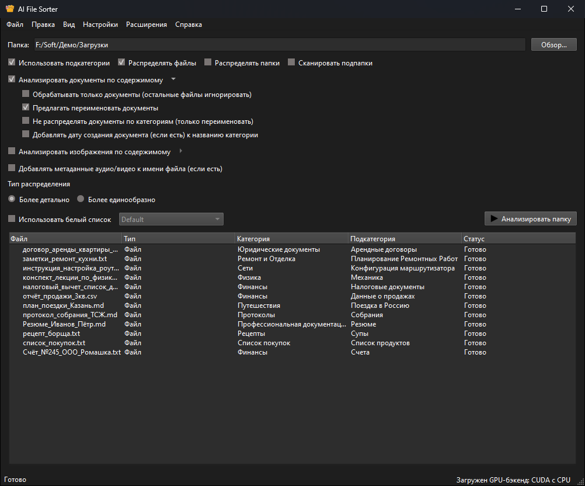
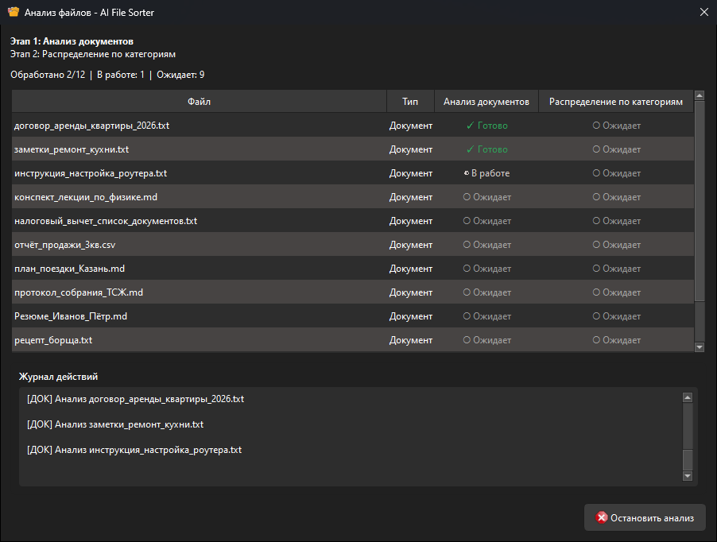
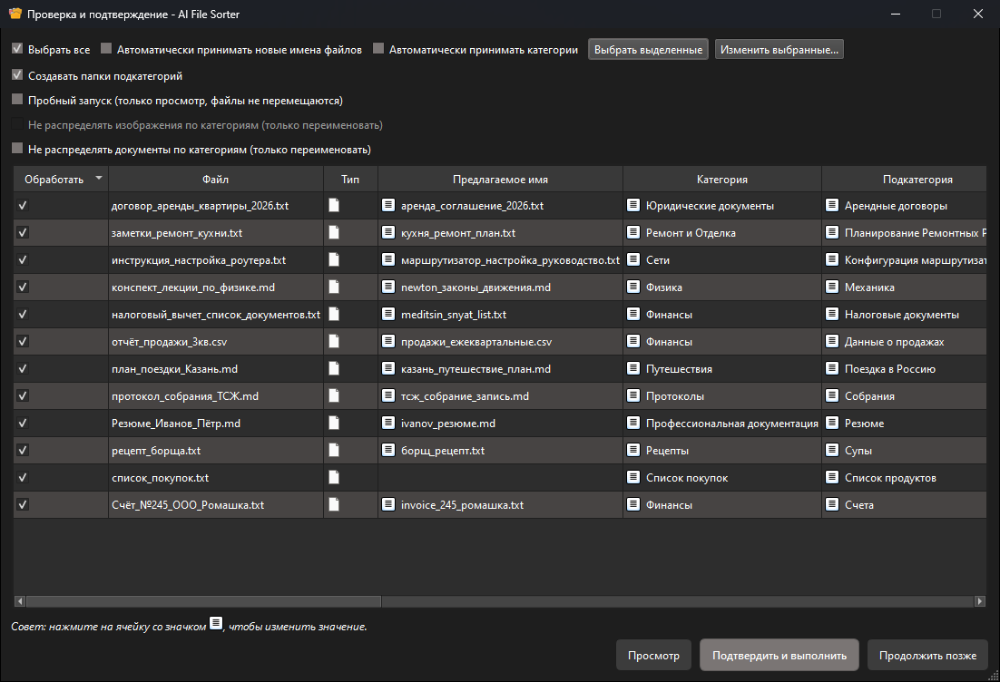
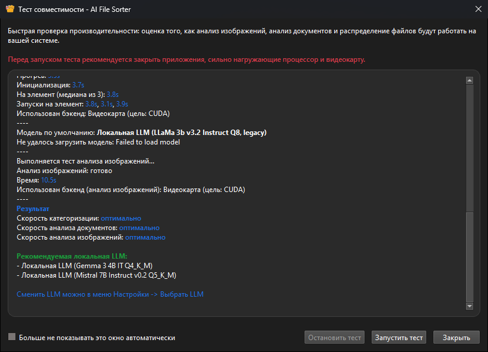
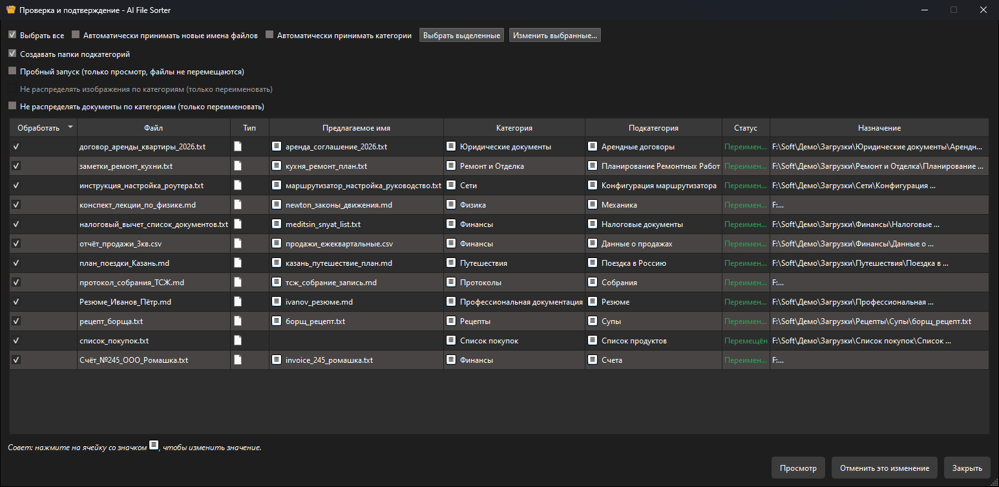

<!-- markdownlint-disable MD046 -->
# file-sorter-ru

**Неофициальный форк проекта [AI File Sorter](https://github.com/hyperfield/ai-file-sorter): русский интерфейс и полная поддержка кириллицы**

[](#что-нового-в-русской-версии)
[](#что-нового-в-русской-версии)
[](LICENSE)

> **Это неофициальный форк** проекта [AI File Sorter](https://github.com/hyperfield/ai-file-sorter) автора hyperfield. Форк не связан с автором оригинала и не одобрен им; название и логотип AI File Sorter принадлежат автору оригинала (см. [TRADEMARKS.md](TRADEMARKS.md)).
>
> В форке добавлен **русский интерфейс** и исправлена работа с **кириллицей**: русские имена файлов и папок, профиль Windows вида `C:\Users\Иван` и **категории на русском языке**. Эти изменения также предложены автору оригинала, чтобы они попали в официальную версию.
>
> English version of the original documentation: [README.en.md](README.en.md).

AI File Sorter — кроссплатформенное настольное приложение, которое с помощью ИИ раскладывает файлы по папкам и предлагает понятные, единообразные имена для изображений, документов и поддерживаемых аудио- и видеофайлов. Оно помогает разобрать завалы, навести порядок и облегчить поиск файлов в будущем — будь то разбор, архивирование или долгое хранение.

<p align="center">
  
</p>

Приложение умеет локально анализировать изображения встроенными визуальными LLM и предлагать осмысленные имена. Например, безликий `IMG_2048.jpg` может превратиться в `облака_над_озером.jpg`. Так же оно анализирует текст поддерживаемых документов и предлагает более понятные имена по содержимому. Для аудио и видео используются метаданные, уже записанные в файл: если есть год, исполнитель, альбом или название, программа предложит имя вида `2024_исполнитель_альбом_название.mp3`. Любое предложение можно проверить, изменить или отклонить до того, как что-то изменится.

AI File Sorter помогает разобрать «Загрузки», внешние диски или сетевое хранилище (NAS), группируя файлы по именам, типам, контексту папок и результатам прошлых сортировок.

Вместо жёстких правил приложение сочетает предложения ИИ с необязательными белыми списками, недавними похожими результатами и вашими подтверждёнными решениями. Так сортировка со временем становится единообразнее, а последнее слово всегда остаётся за вами.

Для каждого файла предлагаются категория (и при желании подкатегория), а для поддерживаемых типов — ещё и новое имя. После подтверждения нужные папки создаются автоматически, и файлы раскладываются по ним.

**Конфиденциальность прежде всего.**
AI File Sorter может работать полностью на вашем устройстве. С локальной моделью файлы, их имена, изображения и метаданные остаются на компьютере, телеметрия не отправляется. Интернет нужен только если вы сами выберете удалённую модель.

---

#### Как это работает

1. Укажите папку или диск.
2. Файлы (и содержимое изображений, если включено) анализируются выбранной локальной или удалённой моделью.
3. Формируются предложения категорий и новых имён.
4. Вы проверяете и при необходимости правите их — и только потом что-то меняется.

---

## Что нового в русской версии

Оригинальная программа плохо работала с кириллицей в Windows: анализ падал с ошибкой
`MultiByteToWideChar failed while converting UTF-8 to path`, программа могла не запуститься у пользователя с русским именем
учётной записи, а русские названия категорий отбрасывались. В этой версии это исправлено:

**Кириллица и другие не-латинские символы**

- **Русские имена файлов и папок** обрабатываются, перемещаются и переименовываются без ошибок и «кракозябр».
- **Профиль Windows на кириллице** (`C:\Users\Иван\...`): настройки, журналы, кэш, базы данных и папка моделей открываются корректно.
- Программа работает в UTF-8 независимо от системной кодировки (CP1251 и т. п.) — в исполняемые файлы встроен манифест `activeCodePage=UTF-8`.
- Исходники компилируются с `/utf-8`, поэтому сборка на русской Windows больше не портит строки в коде.
- Байтовые `tolower`/`isalpha` больше не повреждают UTF-8 (раньше на русской локали буквы «Р»/«С» из CP1251 ломали байты кириллицы), а десятичная запятая не мешает разбору чисел.

**Русские категории и имена**

- Ответы модели с кириллицей разбираются правильно, включая метки «Категория:» / «Подкатегория:».
- Длина названия категории считается в символах, а не в байтах — русские названия длиннее 40 букв больше не отбрасываются.
- Исправлена склейка категорий в одну папку вида «Юридические документы , subcategory Договоры аренды» (ошибка оригинала, проявлялась при переводе категорий на любой не-английский язык).
- Названия мест в именах фото (например, «москва») сохраняют кириллицу.
- Текст длинных документов обрезается перед отправкой модели по границе символа, а не посреди русской буквы.

**Русский интерфейс**

- Полный перевод интерфейса (569 строк), краткое руководство и заметки для Windows на русском.
- При первом запуске на русской системе язык интерфейса выбирается автоматически.
- Окно выбора модели при первом запуске теперь тоже на русском (в оригинале оно всегда было английским — перевод подключался позже).
- Журнал действий в окне анализа переведён («[ДОК] Анализ …»); в оригинале эти строки не переводились ни на один язык.

**Тесты**

- Добавлены юнит-тесты на кириллицу (пути, профиль, настройки, базы, сканирование, перемещение, разбор ответов модели, перевод интерфейса).
- В живые тесты с настоящей моделью добавлены русские сценарии, в том числе сортировка файлов с русскими именами из папки «Входящие документы» по русским категориям.

Проверено на Windows 11 (русская локаль, CP1251) с Gemma 3 4B на CPU и на GPU (CUDA, RTX 4060).
Полный список изменений — в [CHANGELOG.md](CHANGELOG.md), раздел `[Unreleased]`.

---

## Безопасный первый запуск

Если вы пробуете AI File Sorter впервые, начните с маленькой тестовой папки, а не с целого архива или диска. Скопируйте 20–50 файлов из «Загрузок», скриншоты, фото или документы во временную папку, запустите анализ и внимательно посмотрите таблицу проверки, прежде чем что-то применять.

Так первый запуск почти ничем не рискует: с локальной моделью файлы остаются на компьютере, ИИ только предлагает категории и имена, а перемещение или переименование происходит лишь после вашего подтверждения. Если вы применили изменения и хотите их откатить, выберите **Правка → Отменить последний запуск**.

---

## Где взять программу

Готовых сборок этого форка пока нет — её нужно собрать из исходников (см. [Сборка в Windows](#сборка-в-windows)).
Официальные сборки оригинала доступны на [SourceForge](https://sourceforge.net/projects/ai-file-sorter/files/latest/download) и в [Microsoft Store](https://apps.microsoft.com/detail/9npk4dzd6r6s), но **исправлений кириллицы и русского интерфейса в них нет**.

<p align="center">
  
  
</p>

<p align="center">
  
  
</p>

---

- [Что нового в русской версии](#что-нового-в-русской-версии)
- [Безопасный первый запуск](#безопасный-первый-запуск)
- [Где взять программу](#где-взять-программу)
- [Техническая документация](#техническая-документация)
- [Возможности](#возможности)
- [Распределение по категориям](#распределение-по-категориям)
- [Анализ изображений (визуальная LLM)](#анализ-изображений-визуальная-llm)
- [Анализ документов (текстовая LLM)](#анализ-документов-текстовая-llm)
- [Имена файлов по метаданным аудио и видео](#имена-файлов-по-метаданным-аудио-и-видео)
- [Проверка совместимости системы](#проверка-совместимости-системы)
- [Требования](#требования)
- [Сборка в Windows](#сборка-в-windows)
- [Сборка в Linux и macOS](#сборка-в-linux-и-macos)
- [Тесты](#тесты)
- [Выбор бэкенда при запуске](#выбор-бэкенда-при-запуске)
- [Переменные окружения](#переменные-окружения)
- [Кэш и обучение на ваших решениях](#кэш-и-обучение-на-ваших-решениях)
- [Удаление](#удаление)
- [Свой API-ключ OpenAI](#свой-api-ключ-openai)
- [Свой API-ключ Gemini](#свой-api-ключ-gemini)
- [Свой OpenAI-совместимый API](#свой-openai-совместимый-api)
- [Диагностика](#диагностика)
- [Как пользоваться](#как-пользоваться)
- [Сортировка сетевой папки (NAS)](#сортировка-сетевой-папки-nas)
- [Участие в разработке](#участие-в-разработке)
- [Благодарности](#благодарности)
- [Лицензия](#лицензия)
- [Поддержать автора оригинала](#поддержать-автора-оригинала)

---

## Техническая документация

Этот README посвящён установке, возможностям и повседневному использованию. Подробности для разработчиков и интеграций (на английском):

- [Архитектура](docs/architecture.md)
- [Контракт headless-режима](docs/headless-runtime-contract.md)
- [Настройки и переменные окружения](docs/configuration-and-environment.md)
- [Логика распределения по категориям](docs/categorization-behavior.md)
- [Тестирование](docs/testing.md)
- [Контракт обновлений](docs/updater-contract.md)

История версий оригинала — в [CHANGELOG.md](CHANGELOG.md).

---

## Возможности

- **Распределение по категориям с помощью ИИ** — локальные модели на вашем компьютере или удалённые со своим API-ключом.
- **Работа без интернета** — с локальной LLM не нужны ни сеть, ни API-ключ.
- **Надёжная категоризация** — встроенные правила и сопоставление категорий делают результаты стабильнее от запуска к запуску.
- **Гибкие настройки** — белые списки, нормализация таксономии, режимы единообразия и правка при проверке.
- **Два режима**: **Более детально** — более конкретные названия без привязки к широким категориям по умолчанию; **Более единообразно** — устойчивые категории верхнего уровня для похожих файлов.
- **Белые списки категорий** — именованные списки допустимых категорий и подкатегорий, в том числе «ветвящиеся», где у каждой основной категории свои подкатегории. Управление — **Настройки → Белые списки категорий…**, включение — в главном окне.
- **Язык категорий и имён** — категории выбираются на английском «за кулисами» и показываются на выбранном языке (например, на русском). Предлагаемые имена изображений, документов и медиафайлов локализуются так же. Доступные языки зависят от модели.
- **Свои локальные LLM** — регистрация своих GGUF-моделей прямо в окне **Выбрать LLM**. Если добавить подходящий файл MMProj, модель можно использовать и для анализа изображений.
- **Анализ содержимого изображений** — встроенные визуальные модели Gemma 3 4B IT (по умолчанию) и LLaVA 1.6 Mistral 7B, с особой обработкой скриншотов и снимков интерфейсов (есть режим «только переименовать»).
- **Дата снимка в названии категории** (необязательно).
- **Анализ содержимого документов** — краткое описание и предложение имени с помощью той же выбранной LLM.
- **Имена по метаданным аудио и видео** — аккуратные имена в стиле медиатеки из встроенных тегов, с проверкой до переименования.
- **Сортировка таблицы проверки** по имени файла, категории или подкатегории.
- **Интерфейс на Qt6** — лёгкий и отзывчивый.
- **Языки интерфейса**: английский, датский, нидерландский, финский, французский, немецкий, хинди, исландский, итальянский, корейский, норвежский, **русский**, китайский (упрощённый), испанский, шведский и турецкий.
- **Кроссплатформенность** — Windows, macOS и Linux.
- **Локальный кэш** ускоряет повторные запуски, сохраняет подтверждённые категории и предложенные имена, подсказывает недавние категории.
- **Обучение на подтверждённых проверках** — ваши решения сохраняются локально и используются как подсказки, сама модель не меняется.
- **Обслуживание кэша** — **Настройки → Очистить кэш…** и **Настройки → Сбросить обученное поведение…**.
- **Предпросмотр сортировки** и **пробный запуск** без перемещения файлов.
- **Отмена последнего запуска** — работает даже после закрытия окна сортировки.
- **Защита папок проектов** — при рекурсивном сканировании пропускаются проекты Unity, Unreal, Godot, Blender, Git-репозитории и типичные проекты с исходным кодом.
- **Свои ключи удалённых сервисов** — OpenAI, Gemini или любой OpenAI-совместимый сервер, ключи хранятся локально.
- **Уведомления об обновлениях** (относятся к оригинальной программе).
- **Плагины хранилищ** — режимы совместимости для облачных папок из меню **Плагины**.
- **Встроенная справка** — **Справка → Краткое руководство** и **Справка → Вопросы и ответы**.

---

## Распределение по категориям

### Режимы

- **Более детально** — гибкий режим с упором на детали. Меньше привязан к стандартной структуре и может выбрать более конкретную категорию верхнего уровня, например `Безопасность / PCI DSS`, `Руководства / Фотокамеры` или `Дикая природа / Львы`. Хорош для смешанных и специализированных папок.
- **Более единообразно** — режим с упором на одинаковость. Использует недавние похожие результаты, чтобы чаще выбирать устойчивые широкие категории: `Документы / PCI DSS`, `Документы / Фотокамеры`, `Изображения / Львы`. Хорош, когда нужна аккуратная однородная структура.
- Переключается в главном окне в блоке **Тип распределения**; выбор сохраняется.

Пример без белого списка:

```text
Более детально
- pci_dss_quick_reference.pdf -> Безопасность / PCI DSS
- camera_setup_manual.pdf -> Руководства / Фотокамеры
- lion_photo.jpg -> Дикая природа / Львы

Более единообразно
- pci_dss_quick_reference.pdf -> Документы / PCI DSS
- camera_setup_manual.pdf -> Документы / Фотокамеры
- lion_photo.jpg -> Изображения / Львы
```

### Язык категорий

- Категории сначала выбираются на английском, а затем показываются на языке из **Настройки → Язык категорий**. Чтобы папки назывались по-русски, выберите там **Russian**.
- Предлагаемые имена изображений, документов и медиафайлов тоже переводятся на этот язык перед проверкой.
- Список языков зависит от модели: **Gemma 3 4B IT** и **свои** локальные модели поддерживают весь список (включая русский), **Mistral 7B** — сокращённый набор (без русского), **Gemma 1.1 7B** — только английский.
- Если языков много, меню разбивается на алфавитные подменю.

### Белые списки категорий

- Включите **Использовать белый список**, чтобы ограничить категории выбранным списком; выключите, чтобы модель выбирала свободнее.
- Управление списками — **Настройки → Белые списки категорий…**. Встроенные списки `Default` и `Documents` создаются, только если списков ещё нет; можно держать несколько списков для разных задач.
- В редакторе три раздела: **Основные категории / папки верхнего уровня**, **Общие подкатегории** (допустимы под любой категорией) и **Подкатегории для отдельных категорий** (у каждой основной категории — свои).
- Общие подкатегории и подкатегории для отдельных категорий — взаимоисключающие варианты: если заполнен один раздел, другой для этого списка отключается.
- «Ветвящиеся» списки удобны, когда в одинаковых широких папках должны быть разные подпапки. Например, `Документы -> Счета, Чеки, Налоги` и `Изображения -> Скриншоты, Фото`: «Скриншоты» допустимы в «Изображениях», но не в «Документах».
- Встроенный список `Documents` устроен именно так: единственная категория верхнего уровня — `Documents`, а счета, чеки, налоги, договоры, отчёты и заметки — её подкатегории.
- Маленьким локальным моделям проще работать с узкими списками, но большие списки больше не попадают в промпт целиком: приложение сокращает их до подходящих кандидатов.
- Белые списки работают в обоих режимах; с **Более единообразно** модель придерживается их строже всего.

---

## Анализ изображений (визуальная LLM)

Анализ изображений может работать локально: модель понимает, что изображено, и предлагает категорию или имя. API-ключ не нужен.

С версии 1.9.0 визуальная модель по умолчанию — **Gemma 3 4B IT**. Скриншоты, снимки веб-страниц, дашборды, формы и макеты получают дополнительные подсказки, чтобы категория описывала то, что на экране, а не «программу» как таковую.

Встроено два визуальных бэкенда: Gemma 3 4B IT и LLaVA 1.6 Mistral 7B. Каждому нужны два GGUF-файла: основная модель и соответствующий файл-проектор `mmproj`.

Тот же GGUF Gemma 3 4B IT доступен и как локальная модель для категоризации. Для категоризации и анализа документов `mmproj` не нужен; если модель уже скачана для анализа изображений, она используется повторно.

Свои локальные GGUF-модели тоже можно использовать для изображений, если указать для них файл MMProj — они появятся в списке **Визуальная модель**.

### Нужные файлы

В окне **Выбрать LLM** есть раздел «Модели для анализа изображений»:

- **Визуальная текстовая модель (GGUF)** — формирует описание и предложение имени.
- **Файл `mmproj` (GGUF)** — мультимодальный проектор, без которого модель не принимает изображения.

Нужны оба файла. Если одного нет, анализ изображений отключается, и приложение предложит открыть **Выбрать LLM**, чтобы скачать их. Адреса загрузки можно переопределить переменными `LLAVA_MODEL_URL` / `LLAVA_MMPROJ_URL` или `GEMMA3_4B_MODEL_URL` / `GEMMA3_4B_MMPROJ_URL` (см. [Переменные окружения](#переменные-окружения)).

Там же есть **Хранилище моделей** — папка для скачанных моделей. Оставьте пустым, чтобы использовать путь по умолчанию.

### Параметры в главном окне

- **Анализировать изображения по содержимому** — запускает визуальную LLM для поддерживаемых изображений.
- **Обрабатывать только изображения** — в этом запуске игнорируются остальные файлы.
- **Добавлять дату создания изображения к названию категории** — добавляет `ГГГГ-ММ-ДД` из метаданных. Недоступно в режиме «только переименовать».
- **Добавлять дату и место съёмки к имени файла** — дата берётся из EXIF, название места определяется онлайн по GPS-координатам (нужен интернет).
- **Предлагать переименовать изображения** — в окне проверки появляется столбец **Предлагаемое имя**; его можно отредактировать.
- **Не распределять изображения по категориям (только переименовать)** — изображения остаются на месте, применяются только переименования.

Отдельный флажок **Добавлять метаданные аудио/видео к имени файла** управляет именами медиафайлов — см. [Имена файлов по метаданным аудио и видео](#имена-файлов-по-метаданным-аудио-и-видео).

---

## Анализ документов (текстовая LLM)

Анализ документов использует ту же выбранную LLM: извлекает текст, кратко описывает содержимое и при желании предлагает имя. Дополнительно скачивать ничего не нужно.

### Поддерживаемые форматы

- Текст: `.txt`, `.md`, `.rtf`, `.csv`, `.tsv`, `.json`, `.xml`, `.yml`/`.yaml`, `.ini`/`.cfg`/`.conf`, `.log`, `.html`/`.htm`, `.tex`, `.rst`
- PDF: `.pdf` (встроенный PDFium; запасной вариант через `pdftotext` — только при сборке с `-DAI_FILE_SORTER_REQUIRE_EMBEDDED_PDF_BACKEND=OFF`)
- Office/OpenOffice: `.docx`, `.xlsx`, `.pptx`, `.odt`, `.ods`, `.odp`
- Старые двоичные форматы `.doc`, `.xls`, `.ppt` пока не поддерживаются.

### Параметры в главном окне

- **Анализировать документы по содержимому** — текст документа передаётся LLM для описания и предложения имени.
- **Обрабатывать только документы** — в этом запуске игнорируются остальные файлы.
- **Предлагать переименовать документы** — столбец **Предлагаемое имя** в окне проверки.
- **Не распределять документы по категориям (только переименовать)**.
- **Добавлять дату создания документа к названию категории** — добавляет `ГГГГ-ММ`.

---

## Имена файлов по метаданным аудио и видео

Приложение превращает встроенные теги медиафайлов в аккуратные единообразные имена вида `год_исполнитель_альбом_название.ext`. Как и любые переименования, ничего не меняется до вашего подтверждения.

- Аудио: `.aac`, `.aif`, `.aiff`, `.alac`, `.ape`, `.flac`, `.m4a`, `.mp3`, `.ogg`, `.oga`, `.opus`, `.wav`, `.wma`
- Видео: `.3gp`, `.avi`, `.flv`, `.m4v`, `.mkv`, `.mov`, `.mp4`, `.mpeg`, `.mpg`, `.mts`, `.m2ts`, `.ts`, `.webm`, `.wmv`
- Встроенное чтение тегов: MP3 (`ID3v1`/`ID3v2`), FLAC и OGG/Opus (Vorbis comments), контейнеры семейства MP4 (`.m4a`, `.mp4`, `.m4v`, `.mov`, `.3gp`). При сборке с `MediaInfoLib` поддерживаются и другие контейнеры.

---

## Проверка совместимости системы

**Проверка совместимости системы** — быстрый тест, который оценивает, насколько хорошо ваш компьютер справится с:

- **распределением по категориям** выбранными локальными LLM;
- **анализом документов** по содержимому;
- **анализом изображений** (визуальная LLM).

Запуск — **Файл → Проверка совместимости системы…**. Тест работает, только если скачана хотя бы одна локальная или визуальная модель.

Что он делает:

- определяет число потоков процессора и доступные GPU-бэкенды (Vulkan/CUDA);
- замеряет небольшую задачу категоризации и анализа документов для моделей по умолчанию;
- замеряет один анализ изображения, если есть файлы визуальной модели;
- выдаёт оценку скорости (оптимально / приемлемо / долговато) и рекомендует локальную LLM.

Совет: перед тестом закройте программы, сильно нагружающие процессор и видеокарту.

---

## Требования

- **ОС**: Windows, Linux или macOS.
- **Компилятор**: с поддержкой C++20 (MSVC 2022 или новее в Windows, `g++`/`clang++` в Linux/macOS).
- **Qt 6**: модули Core, Gui, Widgets и инструменты Qt (в Windows ставятся через vcpkg автоматически).
- **Библиотеки**: `curl`, `sqlite3`, `fmt`, `spdlog`, `libmediainfo`, а также llama.cpp, собираемая скриптами проекта. В Windows сторонние библиотеки ставятся по манифесту `app/vcpkg.json`.
- **Для анализа документов** (в комплекте): PDFium, libzip, pugixml.
- **Необязательно — GPU**: CUDA для видеокарт NVIDIA или Vulkan 1.2+. Программа сама выбирает лучший бэкенд: CUDA → Vulkan → CPU.
- **Для удалённых моделей** (необязательно): свой ключ OpenAI, Gemini или адрес OpenAI-совместимого сервера.

> **Совет по скорости.** На CPU небольшие модели вроде Gemma 3 4B могут не укладываться в стандартный лимит ожидания ответа (60 секунд на файл), особенно с русским текстом. Если видите ошибку `Timed out waiting for LLM response`, используйте видеокарту или увеличьте лимит переменной `AI_FILE_SORTER_LOCAL_LLM_TIMEOUT` (например, `300`).

---

## Сборка в Windows

Ниже — путь, который проверен на Windows 11 с русской локалью. MSYS2 для него не нужен.

### 1. Установите инструменты

```powershell
winget install Git.Git GitHub.cli Kitware.CMake Ninja-build.Ninja
```

Также нужна **Visual Studio 2022 или новее** (подойдёт бесплатная Community или Build Tools) с компонентом **«Разработка классических приложений на C++»**.

Для ускорения на NVIDIA установите драйвер и полный **CUDA Toolkit**, затем проверьте в новом окне терминала:

```powershell
nvidia-smi
nvcc --version
```

### 2. Клонируйте репозиторий и vcpkg

```powershell
git clone --recurse-submodules https://github.com/AuraSTX/file-sorter-ru.git
git clone https://github.com/microsoft/vcpkg.git C:\dev\vcpkg
C:\dev\vcpkg\bootstrap-vcpkg.bat -disableMetrics
setx VCPKG_ROOT C:\dev\vcpkg
```

Скрипты сборки сами находят vcpkg в `<диск>:\dev\vcpkg`, `<диск>:\vcpkg` или по переменной `VCPKG_ROOT`.

### 3. Соберите зависимости и программу

Все команды выполняются в **Developer PowerShell for Visual Studio** (или после запуска `vcvars64.bat`) из корня репозитория:

```powershell
Set-Location file-sorter-ru
Set-ExecutionPolicy -Scope Process -ExecutionPolicy Bypass

# zlib для libzip
C:\dev\vcpkg\vcpkg.exe install zlib:x64-windows

# libzip (встроенная копия)
cmake -S external\libzip -B external\libzip\build -A x64 `
  -DCMAKE_TOOLCHAIN_FILE=C:/dev/vcpkg/scripts/buildsystems/vcpkg.cmake -DVCPKG_TARGET_TRIPLET=x64-windows `
  -DBUILD_SHARED_LIBS=OFF -DBUILD_DOC=OFF -DENABLE_BZIP2=OFF -DENABLE_LZMA=OFF -DENABLE_ZSTD=OFF `
  -DENABLE_OPENSSL=OFF -DENABLE_GNUTLS=OFF -DENABLE_MBEDTLS=OFF -DENABLE_COMMONCRYPTO=OFF -DENABLE_WINDOWS_CRYPTO=OFF
cmake --build external\libzip\build --config Release

# llama.cpp: CPU-вариант без OpenBLAS (MSYS2 не нужен)
.\app\scripts\build_llama_windows.ps1 cuda=off vulkan=off blas=off

# llama.cpp: CUDA-вариант (если есть NVIDIA; cudaarch — архитектура вашей карты, например 89 для RTX 40xx)
.\app\scripts\build_llama_windows.ps1 cuda=on vulkan=off cudaarch=89

# Приложение и тесты (при первом запуске vcpkg соберёт Qt — это 1–2 часа)
.\app\build_windows.ps1 -Configuration Release -Variants Standard -BuildTests
```

Готовая программа: `app\build-windows\Release\aifilesorter.exe`. Это загрузчик: он сам выбирает CUDA, Vulkan или CPU и запускает `aifilesorter-bin.exe`.

Полезно знать:

- `-Clean` — пересобрать с нуля; `-SkipDeploy` — без копирования DLL рядом с программой; `-Parallel N` — число параллельных задач.
- Для Vulkan нужен LunarG Vulkan SDK; запускайте `build_llama_windows.ps1 cuda=off vulkan=on`.
- Если хотите CPU-вариант с OpenBLAS (быстрее на процессоре), установите OpenBLAS через MSYS2 (`pacman -S mingw-w64-ucrt-x86_64-openblas`) и уберите `blas=off`.
- Альтернатива с Qt из официального установщика описана в [README.en.md](README.en.md#windows).

> Программа использует ту же папку настроек, что и установленная оригинальная версия (`%APPDATA%\AIFileSorter`). Не держите обе запущенными одновременно — приложение работает в одном экземпляре.

## Сборка в Linux и macOS

Порядок тот же: зависимости → подмодули → libzip → llama.cpp → приложение.

- **Debian/Ubuntu**: `sudo apt install build-essential cmake git qt6-base-dev qt6-base-dev-tools qt6-l10n-tools qt6-tools-dev-tools libcurl4-openssl-dev libjsoncpp-dev libsqlite3-dev libssl-dev libfmt-dev libspdlog-dev libmediainfo-dev zlib1g-dev patchelf`
- **Fedora/RHEL**: `sudo dnf install gcc-c++ cmake git pkgconf-pkg-config qt6-qtbase-devel qt6-qttools-devel libcurl-devel jsoncpp-devel sqlite-devel openssl-devel fmt-devel spdlog-devel libmediainfo-devel openblas-devel patchelf`
- **Arch/Manjaro**: `sudo pacman -S --needed base-devel git cmake qt6-base qt6-tools curl jsoncpp sqlite openssl fmt spdlog mediainfo patchelf`
- **macOS (Apple Silicon, macOS 15+)**: `brew install qt curl jsoncpp sqlite openssl fmt spdlog mediainfo cmake git pkgconfig libffi`

```bash
git clone --recurse-submodules https://github.com/AuraSTX/file-sorter-ru.git
cd file-sorter-ru
cmake -S external/libzip -B external/libzip/build -DBUILD_SHARED_LIBS=OFF -DBUILD_DOC=OFF \
  -DENABLE_BZIP2=OFF -DENABLE_LZMA=OFF -DENABLE_ZSTD=OFF -DENABLE_OPENSSL=OFF -DENABLE_GNUTLS=OFF \
  -DENABLE_MBEDTLS=OFF -DENABLE_COMMONCRYPTO=OFF -DENABLE_WINDOWS_CRYPTO=OFF
cmake --build external/libzip/build

./app/scripts/build_llama_linux.sh cuda=off vulkan=off   # Linux, CPU
# ./app/scripts/build_llama_linux.sh cuda=on vulkan=off  # Linux, CUDA
# ./app/scripts/build_llama_macos.sh --arm64             # macOS

cd app && make -j"$(nproc)"    # программа: app/bin/aifilesorter
```

Подробности (сборка CUDA/Vulkan в Linux, пакеты `.deb`/`.rpm`, варианты под M1/M2) — в [README.en.md](README.en.md#linux).
Исправления кириллицы этого форка касаются в первую очередь Windows; в Linux и macOS UTF-8 используется системой по умолчанию.

---

## Тесты

Юнит-тесты на Catch2 собираются с флагом `-BuildTests` (Windows) или `-DAI_FILE_SORTER_BUILD_TESTS=ON`:

```powershell
.\app\build_windows.ps1 -Configuration Release -Variants Standard -BuildTests -RunTests
```

Запустить только тесты кириллицы:

```powershell
$env:QT_QPA_PLATFORM = "minimal"
.\app\build-windows\tests\Release\ai_file_sorter_tests.exe -# "[#test_cyrillic_support]"
```

### Живые тесты с настоящей моделью

Обычные тесты не запускают реальную модель. Для этого есть `tests/live_llm/headless_live_llm_tests.py`: он запускает программу в headless-режиме с изолированными настройками, создаёт тестовые файлы и проверяет результат на диске. Ваши настройки при этом не затрагиваются.

```powershell
python tests\live_llm\headless_live_llm_tests.py `
  --app app\build-windows\Release\aifilesorter.exe `
  --model "$env:APPDATA\AIFileSorter\llms\gemma-3-4b-it\model.gguf" `
  --backend cuda `
  --only russian `
  --skip-downloads
```

Русские сценарии: `rename_documents_russian`, `categorize_russian_cyrillic_paths`, `rename_images_russian` (для последнего нужны `AI_FILE_SORTER_LIVE_VISUAL_MODEL` и `AI_FILE_SORTER_LIVE_VISUAL_MMPROJ`).
Остальные параметры раннера — в `tests/live_llm/README.md`.

---

## Выбор бэкенда при запуске

Загрузчик `aifilesorter.exe` (Windows) и `run_aifilesorter.sh` (Linux) принимают флаги:

- `--cuda={on|off}` — принудительно включить или выключить CUDA;
- `--vulkan={on|off}` — принудительно включить или выключить Vulkan.

Без флагов бэкенд выбирается автоматически: CUDA → Vulkan → CPU. Включить оба сразу нельзя.

Про видеопамять:

- Число слоёв на видеокарте (`n_gpu_layers`) подбирается по свободной VRAM; для встроенной графики — не больше 4 ГБ.
- При нехватке VRAM программа уменьшает выгрузку на видеокарту или переходит на CPU. Для комфортной работы с изображениями желательно 8 ГБ+.
- Переопределение: `AI_FILE_SORTER_N_GPU_LAYERS` (`-1` — авто, `0` — только CPU) или `AI_FILE_SORTER_GPU_BACKEND=cpu`.
- `AI_FILE_SORTER_VISUAL_USE_GPU=0` переводит визуальный энкодер на CPU, если не хватает видеопамяти.

## Переменные окружения

Бэкенд и GPU:

- `AI_FILE_SORTER_GPU_BACKEND` — `auto` (по умолчанию), `vulkan`, `cuda` или `cpu`.
- `AI_FILE_SORTER_N_GPU_LAYERS` — число слоёв на GPU; `-1` — авто, `0` — только CPU.
- `AI_FILE_SORTER_CTX_TOKENS` — длина контекста локальной LLM (по умолчанию 2048, допустимо 512–8192).
- `AI_FILE_SORTER_GGML_DIR` — папка с библиотеками бэкенда ggml.

Визуальная LLM:

- `LLAVA_MODEL_URL`, `LLAVA_MMPROJ_URL` — адреса загрузки LLaVA 1.6 Mistral 7B.
- `GEMMA3_4B_MODEL_URL`, `GEMMA3_4B_MMPROJ_URL` — адреса загрузки Gemma 3 4B IT.
- `AI_FILE_SORTER_VISUAL_USE_GPU` — `1` — визуальный энкодер на GPU, `0` — на CPU.

Таймауты и журналы:

- `AI_FILE_SORTER_LOCAL_LLM_TIMEOUT` — ожидание ответа локальной LLM, секунд (по умолчанию 60).
- `AI_FILE_SORTER_REMOTE_LLM_TIMEOUT` — ожидание ответа OpenAI/Gemini (по умолчанию 10).
- `AI_FILE_SORTER_CUSTOM_LLM_TIMEOUT` — ожидание ответа своего OpenAI-совместимого API (по умолчанию 60).
- `AI_FILE_SORTER_REMOTE_REQUESTS_PER_MINUTE` — ограничение частоты запросов к удалённым сервисам (например, `20`); `0` — без ограничения.
- `AI_FILE_SORTER_LLAMA_LOGS` — подробные журналы llama.cpp (`1`/`true`).

Хранение:

- `AI_FILE_SORTER_CONFIG_DIR` — другая папка настроек (где лежит `config.ini`).
- `AI_FILE_SORTER_LLM_STORAGE_DIR` — папка для скачанных моделей (то же, что **Настройки → Выбрать LLM… → Хранилище моделей**). Устаревший синоним — `AI_FILE_SORTER_LLM_DIR`.
- `CATEGORIZATION_CACHE_FILE` — другое имя файла кэша SQLite в папке настроек.

Переменные и режимы для разработчиков (фид обновлений, тестовый режим GUI `--test`, `--self-test`, live-тест апдейтера) описаны в [README.en.md](README.en.md#environment-variables).

---

## Кэш и обучение на ваших решениях

AI File Sorter хранит в папке настроек два вида локальной «памяти»:

- **кэш категоризации** — для быстрых повторных запусков и подсказок единообразия;
- отдельную **базу обученного поведения** — категории, которые вы явно подтвердили в окне проверки.

### Кэш категоризации

Результаты хранятся в локальной базе SQLite рядом с `config.ini`: путь к папке, имя и тип файла, категория/подкатегория, режим, время, предложенное имя и отметки о переименовании. Это позволяет пропускать уже обработанные файлы, сохранять предложения между запусками и в режиме **Более единообразно** подсказывать модели недавние похожие категории. Модель при этом не обучается.

Если переименовать или переместить файл из окна проверки, запись в кэше обновляется. Чтобы сбросить кэш папки, согласитесь на повторное распределение, когда программа предложит.

### Обучение на подтверждённых проверках

Подтверждённые категории могут сохраняться и использоваться как подсказки в будущих запусках. Это делает результаты стабильнее, но **не** обучает и не меняет саму модель. Данные хранятся отдельно от кэша; удалить их — **Настройки → Сбросить обученное поведение…**.

### Обслуживание

**Настройки → Очистить кэш…** позволяет посмотреть и очистить кэш категоризации, кэш названий мест для фото и журналы. Скачанные модели управляются отдельно — в **Настройки → Выбрать LLM…**.

---

## Удаление

- **Пакет Debian/Ubuntu**: `sudo apt remove aifilesorter`
- **Сборка из исходников в Linux/macOS**: `cd app && sudo make uninstall`
- **Windows (сборка этого форка)**: удалите папку сборки. Настройки и модели лежат в `%APPDATA%\AIFileSorter` — удалите её, если они больше не нужны.

---

## Свой API-ключ OpenAI

1. Откройте **Настройки → Выбрать LLM**.
2. Выберите **ChatGPT (API-ключ OpenAI)**, вставьте ключ и укажите модель (например, `gpt-4o-mini`, `gpt-4.1` или `o3-mini`).
3. Нажмите **OK**. Ключ хранится локально в `config.ini`; чтобы удалить его, очистите поле.
4. Интернет нужен, только пока выбран этот вариант.

## Свой API-ключ Gemini

1. Зайдите на **https://aistudio.google.com** под своим аккаунтом Google.
2. Откройте **API keys** (или **Get API key**), нажмите **Create API key** и скопируйте ключ.
3. В программе откройте **Настройки → Выбрать LLM**, выберите **Gemini (API-ключ Google AI Studio)**, вставьте ключ и укажите модель (например, `gemini-2.5-flash-lite`, `gemini-2.5-flash` или `gemini-2.5-pro`).
4. Нажмите **OK**. Ключ хранится локально.

> Ключами AI Studio можно пользоваться бесплатно в пределах лимитов Google; для больших квот нужен платёжный аккаунт Google Cloud.

## Свой OpenAI-совместимый API

Подойдут **LM Studio**, **Ollama** или любой сервер с API в стиле OpenAI:

1. Откройте **Настройки → Выбрать LLM**.
2. Выберите **Свой OpenAI-совместимый API (для опытных)**.
3. Нажмите **Добавить…** и укажите имя, базовый URL, модель и, если нужно, API-ключ.
4. Сохраните, выберите сервер в списке и нажмите **OK**.

Время ожидания настраивается переменной `AI_FILE_SORTER_CUSTOM_LLM_TIMEOUT`, частота запросов — `AI_FILE_SORTER_REMOTE_REQUESTS_PER_MINUTE`.

---

## Диагностика

Для отчёта об ошибке есть скрипты сбора диагностики:

- **Windows (PowerShell):** `.\app\scripts\collect_windows_diagnostics.ps1`
- **Linux:** `./app/scripts/collect_linux_diagnostics.sh`
- **macOS:** `./app/scripts/collect_macos_diagnostics.sh`

Скрипт собирает журналы, скрывает типичные личные пути и упаковывает всё в zip. Журналы программы в Windows лежат в `%APPDATA%\AIFileSorter\logs`. Подробнее — [TROUBLESHOOTING.md](TROUBLESHOOTING.md) и [app/scripts/README.md](app/scripts/README.md).

---

## Как пользоваться

1. Запустите программу.
2. Выберите папку для анализа — кнопкой **Обзор…** или на панели **Проводник**.
3. Отметьте нужные параметры в главном окне. Чтобы папки назывались по-русски, выберите **Настройки → Язык категорий → Russian**.
4. Нажмите **Анализировать папку**. Программа просканирует файлы и/или папки согласно выбранным параметрам.

   При рекурсивном сканировании пропускаются распознанные папки проектов (Unity, Unreal, Godot, Blender, Git, проекты с исходным кодом), чтобы не сломать в них относительные пути.

5. Появится окно проверки. Проверьте категории (и подкатегории, если они включены).
6. Нажмите **Подтвердить и выполнить**, чтобы переместить файлы, или **Продолжить позже**, чтобы отложить. Результаты анализа сохраняются, так что продолжить можно в любой момент.

Для пошагового знакомства откройте **Справка → Краткое руководство**, для решения проблем — **Справка → Вопросы и ответы**.

### Пробный запуск и отмена

- В окне проверки можно включить **Пробный запуск (только просмотр, файлы не перемещаются)** — откроется предпросмотр «Откуда / Куда» без перемещения файлов.
- После настоящей сортировки сохраняется план отмены. Откатить изменения можно позже через **Правка → Отменить последний запуск** (по возможности; конфликтующие изменения пропускаются).

---

## Сортировка сетевой папки (NAS)

Действуйте как в разделе [Как пользоваться](#как-пользоваться), но на шаге 2:

- **Windows:** подключите сетевую папку как диск с буквой (например, `Z:`) — [инструкция Microsoft](https://support.microsoft.com/ru-ru/windows/map-a-network-drive-in-windows-29ce55d1-34e3-a7e2-4801-131475f9557d). Сетевые расположения также видны на панели **Проводник** в разделе **Сетевые расположения**.
- **Linux и macOS:** смонтируйте ресурс в локальную папку, например:

  ```sh
  sudo mount -t cifs //192.168.1.100/shared_folder /mnt/nas -o username=myuser,password=mypass,uid=$(id -u),gid=$(id -g)
  ```

---

## Участие в разработке

- Ошибки и предложения по **русской версии** (перевод, кириллица) — в [issues этого репозитория](https://github.com/AuraSTX/file-sorter-ru/issues).
- Всё, что не относится к локализации, лучше сообщать в [оригинальный проект](https://github.com/hyperfield/ai-file-sorter/issues).
- Придерживайтесь существующего стиля кода и документации.

---

## Благодарности

Автор оригинального AI File Sorter — [hyperfield](https://github.com/hyperfield). Используемые проекты:

- Curl: <https://github.com/curl/curl>
- Dotenv: <https://github.com/motdotla/dotenv>
- git-scm: <https://git-scm.com>
- Hugging Face: <https://huggingface.co>
- JSONCPP: <https://github.com/open-source-parsers/jsoncpp>
- Llama: <https://www.llama.com>
- libzip: <https://libzip.org>
- Local File Organizer: <https://github.com/QiuYannnn/Local-File-Organizer>
- llama.cpp: <https://github.com/ggml-org/llama.cpp>
- MediaInfoLib: <https://mediaarea.net/en/MediaInfo>
- Mistral AI: <https://mistral.ai>
- OpenAI: <https://platform.openai.com/docs/overview>
- OpenSSL: <https://github.com/openssl/openssl>
- PDFium: <https://pdfium.googlesource.com/pdfium/>
- Poppler (pdftotext): <https://poppler.freedesktop.org/>
- pugixml: <https://pugixml.org>
- Qt: <https://www.qt.io/>
- spdlog: <https://github.com/gabime/spdlog>
- unzip (Info-ZIP): <https://infozip.sourceforge.net/>

## Лицензия

Проект распространяется под лицензией GNU AFFERO GENERAL PUBLIC LICENSE (GNU AGPL v3), как и оригинал. Подробности — в файле [LICENSE](LICENSE) и на https://www.gnu.org/licenses/agpl-3.0.html. Товарные знаки — см. [TRADEMARKS.md](TRADEMARKS.md).

---

## Поддержать автора оригинала

AI File Sorter развивается автором оригинального проекта. Если программа вам полезна, поддержите его разработку: **[filesorter.app/donate](https://filesorter.app/donate/)** (от $1). Коды пожертвования лишь скрывают периодическое напоминание и не ограничивают бесплатные локальные возможности.

---
